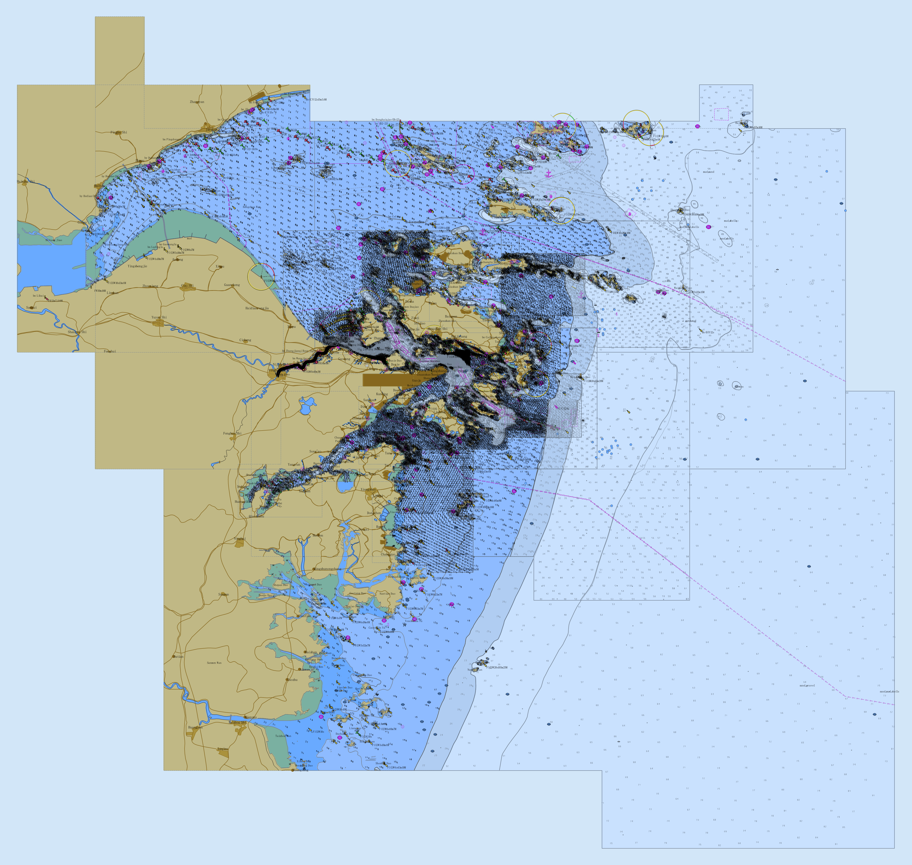
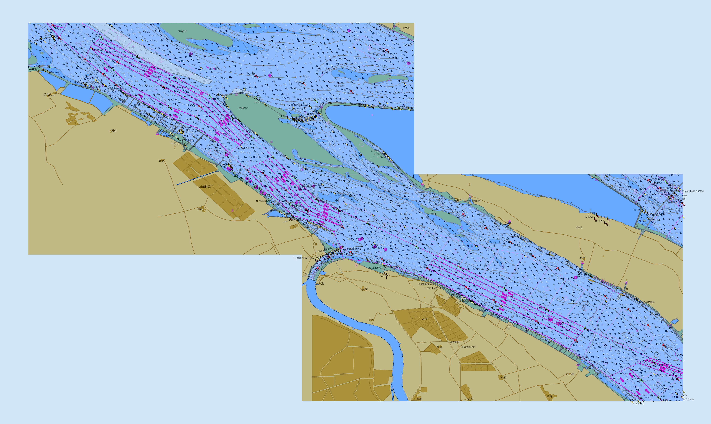
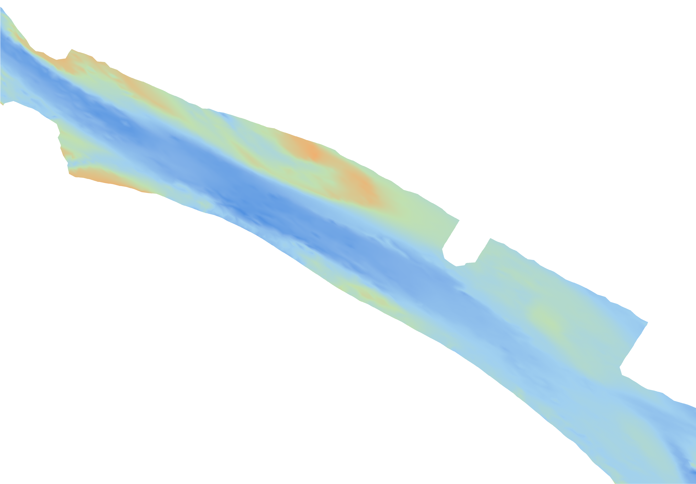
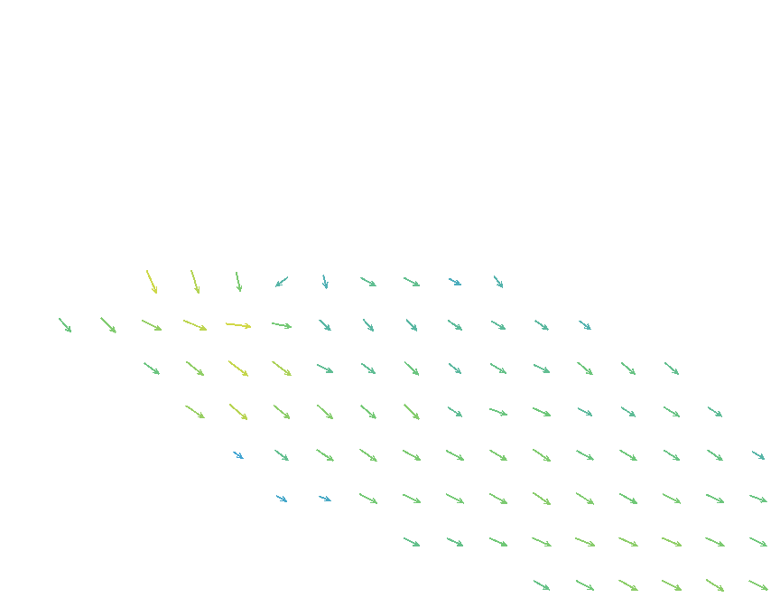

# chart_browser - 专业航海电子海图服务引擎

## 🚀 项目简介

chart_browser 是一款高性能、服务端渲染的专业电子海图引擎，采用 Rust 语言从零构建，完全符合国际海事组织（IHO）S-52/S-57 及新一代 S-100 系列标准。为海事监管、船舶导航、海洋工程、航运物流等领域提供企业级电子海图解决方案。

---

## ✨ 核心特性

### 📋 全标准海图格式支持
- **S-57 矢量海图**：传统电子航海图（ENC）解析与渲染，支持全物标类显示
- **S-101 电子航海图**：新一代矢量海图标准
- **S-102 水深表面**：高分辨率栅格水深数据可视化
- **S-104 水位预报**：时序水位数据动态渲染（按小时分层）
- **S-111 表层海流**：海流矢量场动态可视化

### ⚡ 极致性能表现
- **服务端瓦片渲染**：基于 Axum 异步框架，并发渲染能力强劲
- **两级缓存架构**：内存 LRU 缓存 + 磁盘持久化缓存，二次访问毫秒级响应
- **预加热机制**：启动时自动预渲染关键区域瓦片
- **Rust 原生性能**：无 GC 开销，内存安全，单进程可支持数百并发

### 🎨 专业海图显示
- **严格遵循 S-52 显示规范**：符合 IHO 官方颜色定义和符号标准
- **多种显示模式**：日航、黄昏、夜航三种配色方案
- **安全等深线自定义**：支持用户配置安全水深阈值
- **图层可控**：精细到物标类的显示隐藏控制
- **符号系统完整**：支持所有 IHO S-52 标准符号、线条、区域填充

### 🗺️ 企业级服务能力
- **标准 TMS 瓦片接口**：/tiles/{z}/{x}/{y} 无缝对接 OpenLayers/Leaflet/Mapbox
- **多源数据融合**：自动管理多幅海图拼接，无需人工处理
- **健康检查接口**：/health 端点支持运维监控
- **海图元数据 API**：/api/charts 实时返回所有加载海图的范围信息
- **授权保护机制**：硬件指纹绑定的商业授权体系，保护知识产权

---

## 🖼️ 效果展示

### S-57 矢量海图



### S-101 电子航海图



### S-102 水深表面



### S-111 表层海流（动态）



---

## 🎯 应用场景

| 领域 | 典型应用 |
|------|----------|
| 🚢 **智慧海事监管** | VTS 系统电子海图基底、船舶动态监控平台 |
| ⛴️ **ECDIS 系统** | 船载电子海图显示与信息系统后端服务 |
| 🏗️ **海洋工程** | 海洋油气平台、海底管线、航道工程可视化 |
| 🚚 **航运物流** | 船舶调度系统、船队管理平台的海图支撑 |
| 🔬 **海洋科研** | 海洋环境数据、水文模型结果叠加展示 |
| 🛡️ **搜救应急** | 海上搜救指挥系统的海图决策底图 |
| 📡 **AIS 服务** | AIS 数据服务平台的地理底图 |
| 🚤 **游艇电子设备** | 游艇、公务艇导航系统海图引擎 |

---

## 🏗️ 技术架构

```
chart_browser 海图引擎
├── ISO 8211 解析层    二进制海图文件格式解析器
├── IHO 标准实现层     S-57/S-101/S-102/S-104/S-111 数据模型
├── 渲染引擎层         tiny-skia 矢量图形渲染 + S-52 符号系统
├── 瓦片服务层         Axum Web 服务 + 多级瓦片缓存
└── 数据访问层         海图数据自动发现与范围查询路由
```

**技术栈优势：**
- Rust + Tokio 异步运行时：企业级可靠性保障
- tiny-skia 矢量渲染：无需系统依赖库，单二进制部署
- Moka 内存缓存：高并发下无锁高性能
- HDF5 科学数据支持：原生集成 S-100 栅格数据格式

---

## 📡 API 接口一览

| 接口路径 | 说明 |
|----------|------|
| `GET /` | 内置海图查看器演示页面 |
| `GET /tiles/{z}/{x}/{y}` | S-57/S-101 电子海图瓦片 |
| `GET /s102/tiles/{z}/{x}/{y}` | S-102 水深表面瓦片 |
| `GET /s104/tiles/{z}/{x}/{y}` | S-104 水位预报瓦片 |
| `GET /s111/tiles/{z}/{x}/{y}` | S-111 表层海流瓦片 |
| `GET /api/charts` | 已加载海图元数据列表 |
| `GET /health` | 服务健康状态检查 |

---

## 🚀 快速开始

### 环境要求
- Windows / Linux / macOS 全平台支持
- 单二进制文件，无需 GDAL、PROJ 等系统依赖

### 启动服务
```bash
# 将海图数据放入 data 目录
# 运行服务
chart_browser.exe  # 或 ./chart_browser

# 访问查看器
# http://localhost:3000
```

### 前端集成示例
```javascript
// OpenLayers 集成示例
const layer = new ol.layer.Tile({
  source: new ol.source.XYZ({
    url: 'http://your-server:3000/tiles/{z}/{x}/{y}',
    tileSize: 256,
    projection: 'EPSG:3857'
  })
});
```

---

## 💼 商业合作

我们提供专业的电子海图引擎技术服务，助力您的海事项目快速落地。

### 📦 合作模式

1. **直接授权使用**
   - 单机版/服务端版多种授权模式
   - 按年付费 / 永久授权灵活选择
   - 包含 12 个月技术支持

2. **定制开发服务**
   - 特殊海图格式适配
   - 行业特定功能定制
   - 性能深度优化
   - 跨平台移植（嵌入式 ECDIS 等）

3. **技术咨询服务**
   - 海图数据处理方案咨询
   - IHO S-100 标准体系技术指导
   - 海事 GIS 架构设计顾问

4. **联合产品共建**
   - 与行业伙伴深度合作，共建海事科技产品
   - 源码级合作模式

### 🎯 我们的优势

✅ **专业团队**：核心团队拥有 10 年以上海事 GIS 经验，深度参与国家级海事项目
✅ **技术自主**：完全自主知识产权，无任何第三方 GPL 传染协议风险
✅ **快速响应**：7x24 小时技术支持通道，紧急问题数小时内响应
✅ **持续迭代**：长期 roadmap 投入，持续支持最新 IHO 标准特性
✅ **按需定制**：可根据项目需求快速裁剪、扩展功能

---

## 📞 联系我们

> 厦门市神盛网络科技有限公司

> 期待与您携手，共同推进中国海事数字化产业发展！

- **商务咨询**：获取产品报价、功能演示
- **技术评估**：提供 14 天全功能评估版本
- **项目合作**：深度定制化需求对接
- **联系邮箱**：[502694428@qq.com](mailto:502694428@qq.com)
- **微信咨询**：


---

## 📄 关于本项目

本项目由厦门市神盛网络科技有限公司开发并持有，为商业软件，受著作权法保护。未经授权不得用于任何商业用途。

chart_browser —— 让专业电子海图能力触手可及