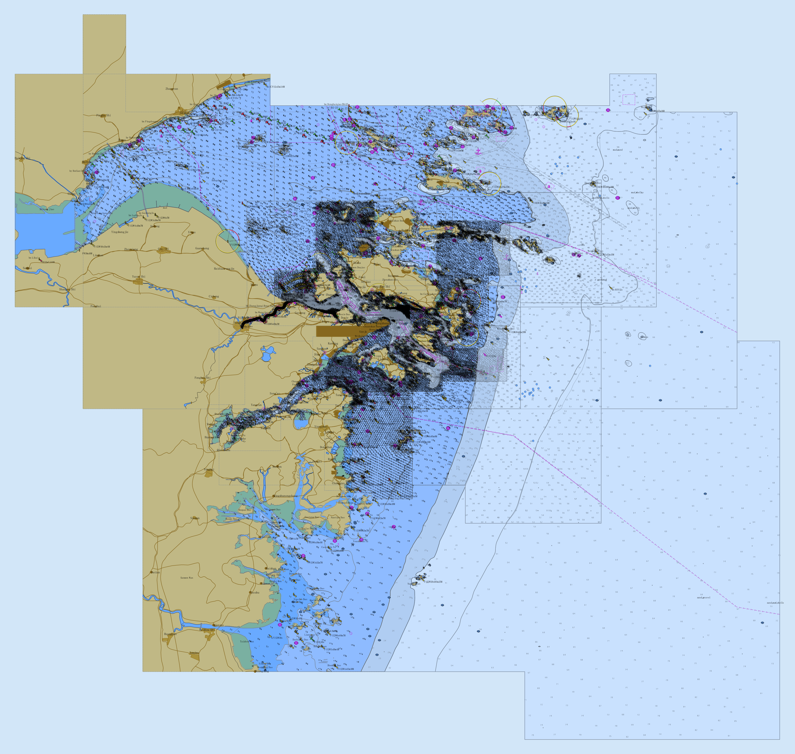
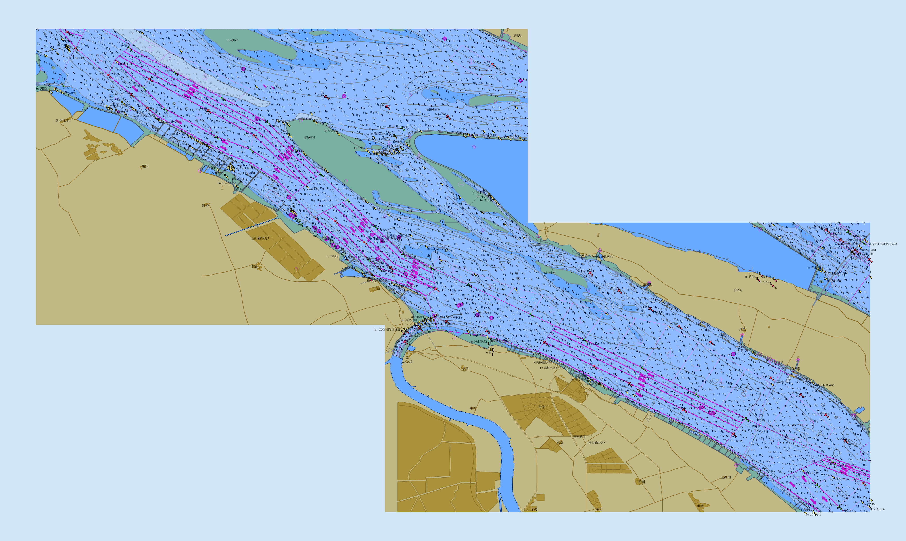
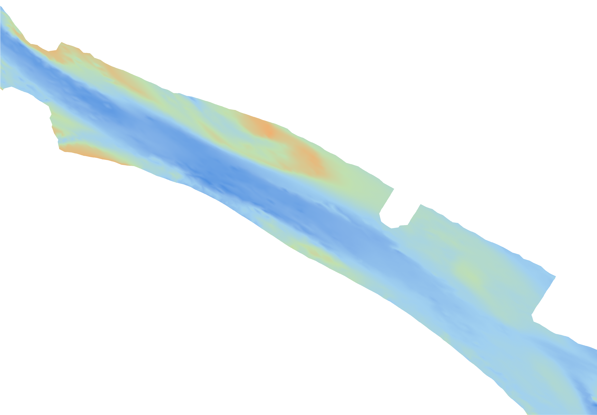
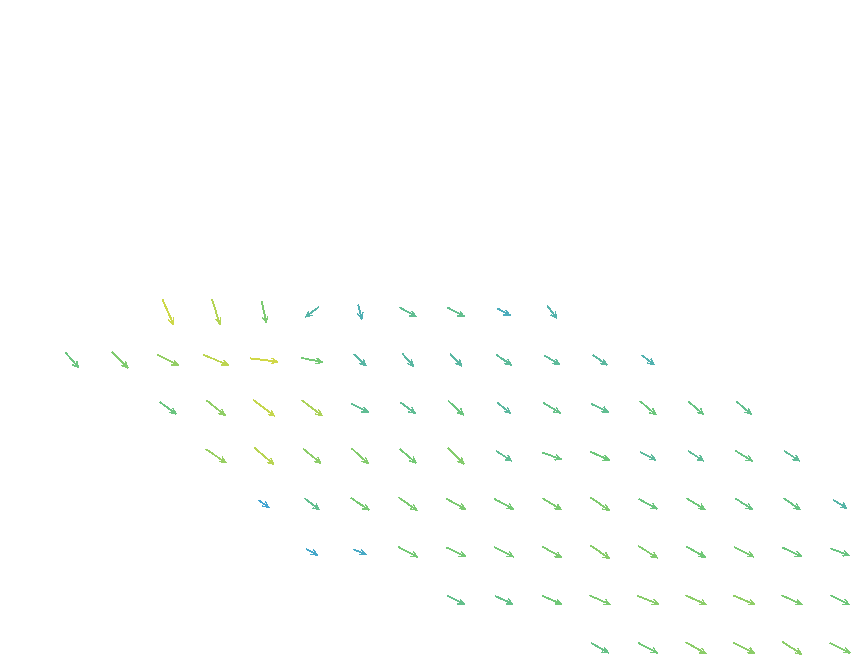

# chart_browser - Professional Marine Electronic Chart Service Engine

## 🚀 Overview

chart_browser is a high-performance, server-side rendered electronic chart engine built from scratch in Rust, fully compliant with the International Hydrographic Organization (IHO) S-52/S-57 and the next-generation S-100 series standards. It delivers enterprise-grade electronic chart solutions for maritime supervision, ship navigation, offshore engineering, shipping logistics and more.

---

## ✨ Key Features

### 📋 Full Support for Standard Chart Formats
- **S-57 Vector Charts**: Traditional Electronic Navigational Charts (ENC) parsing and rendering with full object class display
- **S-101 Electronic Navigational Charts**: Next-generation vector chart standard
- **S-102 Bathymetric Surfaces**: High-resolution gridded depth data visualization
- **S-104 Water Level Forecast**: Time-series water level data rendered dynamically (layered by hour)
- **S-111 Surface Currents**: Dynamic visualization of surface current vector fields

### ⚡ Extreme Performance
- **Server-side Tile Rendering**: Built on the Axum async framework with strong concurrent rendering capability
- **Two-level Cache Architecture**: In-memory LRU cache + persistent disk cache for millisecond responses on repeat access
- **Cache Warm-up**: Automatically pre-renders tiles for key regions on startup
- **Native Rust Performance**: No GC overhead, memory safety, supports hundreds of concurrent requests in a single process

### 🎨 Professional Chart Display
- **Strict S-52 Presentation Compliance**: Conforms to IHO official color definitions and symbol standards
- **Multiple Display Modes**: Day, dusk and night color schemes
- **Customizable Safety Contours**: Configurable safety depth thresholds
- **Layer Control**: Fine-grained show/hide control down to object classes
- **Complete Symbolization**: Supports all IHO S-52 standard symbols, lines and area fills

### 🗺️ Enterprise-grade Service Capabilities
- **Standard TMS Tile API**: `/tiles/{z}/{x}/{y}` seamlessly integrates with OpenLayers/Leaflet/Mapbox
- **Multi-source Data Fusion**: Automatic management and mosaicking of multiple charts without manual effort
- **Health Check API**: `/health` endpoint for operations monitoring
- **Chart Metadata API**: `/api/charts` returns real-time extent information for all loaded charts
- **License Protection**: Hardware fingerprint-bound commercial licensing system to protect intellectual property

---

## 🖼️ Screenshots

### S-57 Vector Chart



### S-101 Electronic Navigational Chart



### S-102 Bathymetric Surface



### S-111 Surface Currents (Animated)



---

## 🎯 Use Cases

| Sector | Typical Applications |
|--------|----------------------|
| 🚢 **Smart Maritime Supervision** | Electronic chart basemap for VTS systems, vessel traffic monitoring platforms |
| ⛴️ **ECDIS Systems** | Backend service for shipborne Electronic Chart Display and Information Systems |
| 🏗️ **Offshore Engineering** | Visualization of offshore oil & gas platforms, subsea pipelines, waterway engineering |
| 🚚 **Shipping & Logistics** | Chart support for vessel dispatch systems and fleet management platforms |
| 🔬 **Marine Research** | Overlay display of marine environmental data and hydrodynamic model results |
| 🛡️ **Search & Rescue** | Chart decision basemap for maritime SAR command systems |
| 📡 **AIS Services** | Geographic basemap for AIS data service platforms |
| 🚤 **Yacht Electronics** | Chart engine for yacht and patrol boat navigation systems |

---

## 🏗️ Architecture

```
chart_browser Chart Engine
├── ISO 8211 Parsing Layer    Binary chart file format parser
├── IHO Standards Layer       S-57/S-101/S-102/S-104/S-111 data models
├── Rendering Engine Layer    tiny-skia vector rendering + S-52 symbol system
├── Tile Service Layer        Axum web service + multi-level tile cache
└── Data Access Layer         Automatic chart discovery and extent query routing
```

**Technology Stack Advantages:**
- Rust + Tokio async runtime: enterprise-grade reliability
- tiny-skia vector rendering: no system library dependencies, single-binary deployment
- Moka in-memory cache: lock-free high performance under heavy concurrency
- HDF5 scientific data support: native integration of S-100 gridded data formats

---

## 📡 API Reference

| Endpoint | Description |
|----------|-------------|
| `GET /` | Built-in chart viewer demo page |
| `GET /tiles/{z}/{x}/{y}` | S-57/S-101 electronic chart tiles |
| `GET /s102/tiles/{z}/{x}/{y}` | S-102 bathymetric surface tiles |
| `GET /s104/tiles/{z}/{x}/{y}` | S-104 water level forecast tiles |
| `GET /s111/tiles/{z}/{x}/{y}` | S-111 surface current tiles |
| `GET /api/charts` | Metadata list of loaded charts |
| `GET /health` | Service health status check |

---

## 🚀 Quick Start

### Requirements
- Full support for Windows / Linux / macOS
- Single binary, no GDAL, PROJ or other system dependencies required

### Starting the Service
```bash
# Place chart data into the data directory
# Run the service
chart_browser.exe  # or ./chart_browser

# Open the viewer
# http://localhost:3000
```

### Frontend Integration Example
```javascript
// OpenLayers integration example
const layer = new ol.layer.Tile({
  source: new ol.source.XYZ({
    url: 'http://your-server:3000/tiles/{z}/{x}/{y}',
    tileSize: 256,
    projection: 'EPSG:3857'
  })
});
```

---

## 💼 Business Cooperation

We provide professional electronic chart engine services to accelerate your maritime project delivery.

### 📦 Cooperation Models

1. **Direct Licensing**
   - Single-machine / server-side licensing options
   - Flexible annual or perpetual licensing
   - Includes 12 months of technical support

2. **Custom Development**
   - Adaptation of special chart formats
   - Industry-specific feature customization
   - In-depth performance optimization
   - Cross-platform porting (embedded ECDIS, etc.)

3. **Technical Consulting**
   - Chart data processing solutions
   - IHO S-100 standards technical guidance
   - Marine GIS architecture design consulting

4. **Joint Product Development**
   - Deep collaboration with industry partners to co-build maritime technology products
   - Source-code level cooperation

### 🎯 Our Advantages

✅ **Professional Team**: Core team with 10+ years of marine GIS experience, deeply involved in national-level maritime projects
✅ **Independent Technology**: Fully owned intellectual property with no third-party GPL contamination risk
✅ **Rapid Response**: 7x24 technical support channel, response within hours for urgent issues
✅ **Continuous Iteration**: Long-term roadmap investment, continuously supporting the latest IHO standard features
✅ **On-demand Customization**: Rapid tailoring and extension of features to meet project needs

---

## 📞 Contact Us

> Xiamen Shensheng Network Technology Co., Ltd. (厦门市神盛网络科技有限公司)

> We look forward to working with you to advance the digital transformation of the maritime industry!

- **Business Inquiry**: Product pricing and feature demonstrations
- **Technical Evaluation**: 14-day full-feature evaluation version
- **Project Cooperation**: Deep customization requirement discussions
- **Email**: [502694428@qq.com](mailto:502694428@qq.com)
- **WeChat**:


---

## 📄 About This Project

This project is developed and owned by Xiamen Shensheng Network Technology Co., Ltd. (厦门市神盛网络科技有限公司). It is commercial software protected by copyright law. Any commercial use without authorization is prohibited.

chart_browser — Making professional electronic chart capabilities accessible